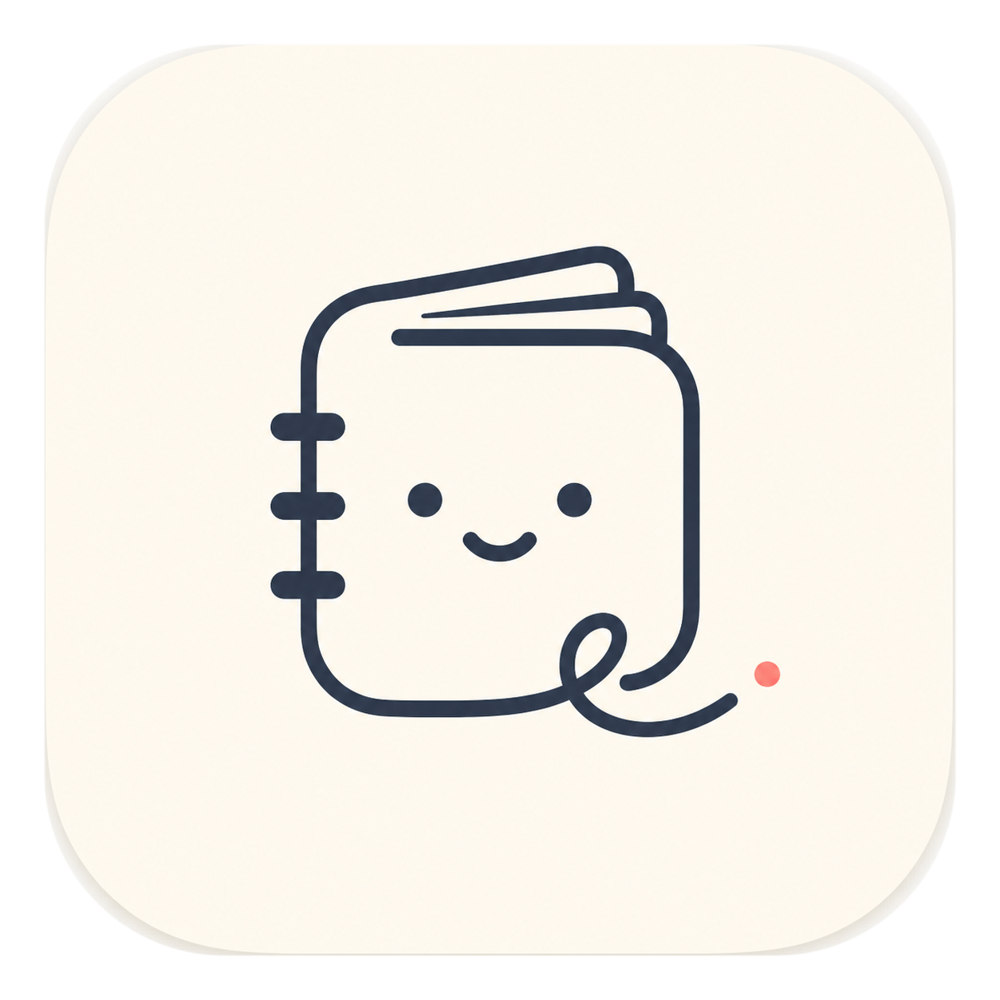
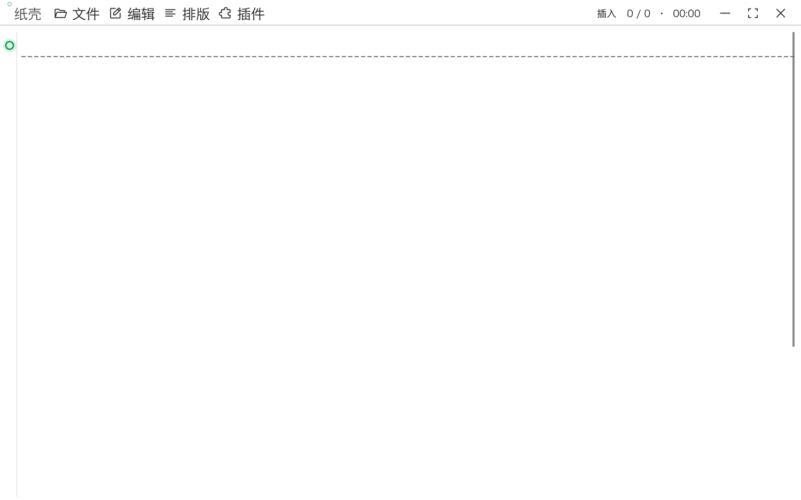

  
  <h1>Paper Shell · 纸壳</h1>
  
<strong>A quiet place to think, write, and revise.</strong>

  
为日常与长文写作打造的轻量桌面编辑器。保持纸面的纯粹，把控思考的节奏。

  

    <a href="https://retricsu.github.io/paper-shell/"><strong>🌐 官方网站</strong></a>
    ·
    <a href="https://github.com/RetricSu/paper-shell/releases/latest"><strong>📥 立即下载</strong></a>
    ·
    <a href="docs/features.md">📖 功能手册</a>
    ·
    <a href="docs/development.md">🛠 开发指南</a>
  

  

    
    
    
    
  

---

**Paper Shell（纸壳）** 将文档重新置于创作中心。它结合了纯文本编辑的无干扰感与长文创作必备的实用工具——组织文件、划词批注、像 Git 一样探索分支版本历史、以及深度中文分词支持，而绝不把编辑器变成杂乱的仪表盘。

## ✨ 核心特性

- **懂中文分词的 Vim 模式**：原生集成 Jieba 结巴分词，`w`、`b`、`dw`、`yw` 等指令精准贴合中文词汇边界，Normal / Insert 模式无缝衔接中文输入法。
- **类 Git 的文档分支历史**：保存即创建内容哈希节点。可视化分支树与正文 Diff 对比，回退历史版本绝不覆盖后续保存，随时拉出新分支。
- **经典白纸与主题皮肤**：默认“经典白纸”极简界面；内置古雅羊皮纸、薄荷清夏、无限地带等多种氛围皮肤，字体、字号、行距即调即看，支持社区皮肤导入。
- **行内批注与专注统计**：独立存储划词批注，不污染原文内容；精准汉字计数与专注时长趋势分析，陪伴长期写作习惯。
- **本地优先与多格式导出**：纯文本存储（txt / md / org / rst），无云端锁定；一键导出高质量矢量 PDF、独立 HTML 与 macOS 原生打印。

## 📥 下载安装

各平台预编译安装包可直接在 [GitHub Releases](https://github.com/RetricSu/paper-shell/releases/latest) 下载：

| 平台 | 架构 | 下载包 | 说明 |
| :--- | :--- | :--- | :--- |
| **macOS** | Universal (通用) | [DMG](https://github.com/RetricSu/paper-shell/releases/latest/download/Paper-Shell-macOS-universal.dmg) · [ZIP](https://github.com/RetricSu/paper-shell/releases/latest/download/Paper-Shell-macOS-universal.zip) | 推荐，支持 Apple Silicon 与 Intel |
| **macOS** | Apple Silicon | [DMG](https://github.com/RetricSu/paper-shell/releases/latest/download/Paper-Shell-macOS-aarch64.dmg) · [ZIP](https://github.com/RetricSu/paper-shell/releases/latest/download/Paper-Shell-macOS-aarch64.zip) | M 系列芯片专属 |
| **macOS** | Intel | [DMG](https://github.com/RetricSu/paper-shell/releases/latest/download/Paper-Shell-macOS-x86_64.dmg) · [ZIP](https://github.com/RetricSu/paper-shell/releases/latest/download/Paper-Shell-macOS-x86_64.zip) | Intel 芯片专属 |
| **Windows** | x86_64 | [ZIP](https://github.com/RetricSu/paper-shell/releases/latest/download/Paper-Shell-Windows-x86_64.zip) | 解压即用 |
| **Linux** | x86_64 | [tar.gz](https://github.com/RetricSu/paper-shell/releases/latest/download/Paper-Shell-Linux-x86_64.tar.gz) | 运行可执行文件 |

> **macOS 首次打开提示“已损坏”或“未验证开发者”？**
> 打开终端执行：`xattr -cr /Applications/Paper\ Shell.app` 即可正常打开。更多细节参见 [应用安全与更新指引](docs/features.md#九应用安全与自动更新机制)。

## 🚀 快速上手

1. **打开或新建**：通过 `Cmd/Ctrl + O` 打开本地文档，或直接在空白纸面上开始书写。
2. **工作区目录**：按 `Cmd/Ctrl + Shift + E`（或点击左上角标题）展开文件树，添加你的写作文件夹。
3. **沉浸排版与模式**：
   - 按 `Esc` 开启/切换 **Vim 模式**。
   - 在顶部 **排版** 菜单中自由挑选字体、字号与行距，在 **设置 → 皮肤与外观** 中切换纸张主题。
4. **历史与统计**：通过 **文件 → 版本历史** 随时回溯灵感演进，点击状态栏字数打开 **写作统计**。

## 📚 详细文档

- 📖 **[功能完整手册 (docs/features.md)](docs/features.md)**：深入了解 Vim 模式、分支版本树机制、行内批注原理、插件系统与皮肤配置。
- 🛠 **[开发与构建指南 (docs/development.md)](docs/development.md)**：从源码构建、本地打包、测试验证与发版流程。
- 🌐 **[访问官方网站](https://retricsu.github.io/paper-shell/)**：在线体验产品画廊与平台自动检测下载。
- 💡 **[问题反馈与建议](https://github.com/RetricSu/paper-shell/issues)**：欢迎提交 Issue 或 Pull Request。

## 📄 开源许可 (License)

Paper Shell is open source software licensed under the [MIT License](LICENSE).
